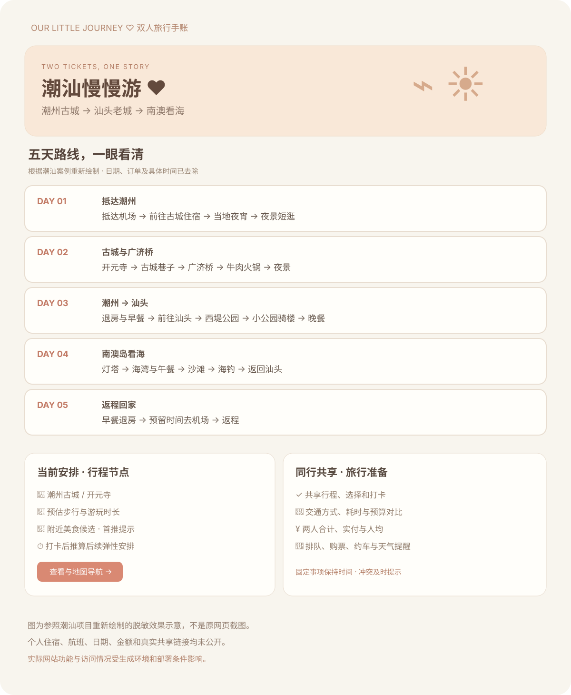
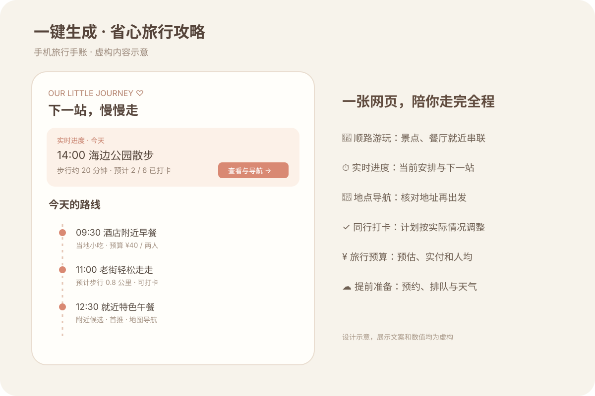
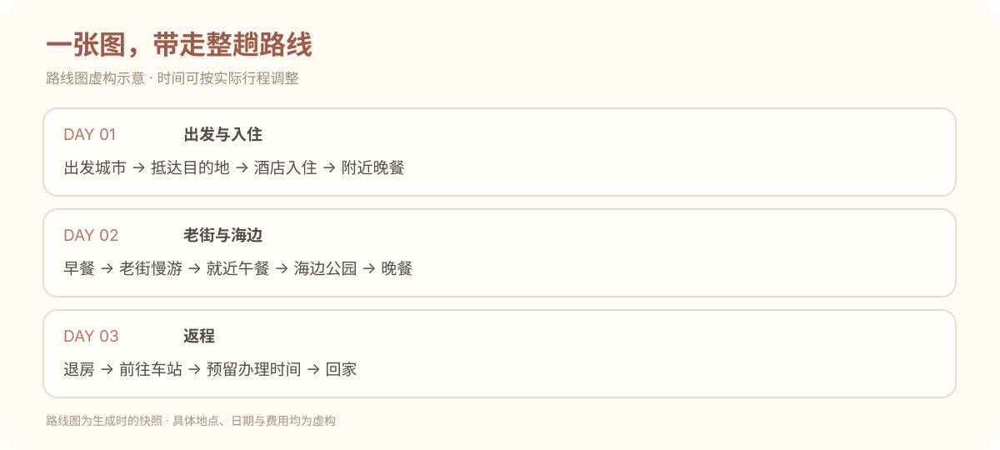

<div align="center">

# 一键生成 · 省心旅行攻略

### 把攻略交给 AI，把时间留给旅行。

**多平台信息整理 · 顺路安排景点与餐厅 · 手机旅行手账 · 一张图看懂路线**

一份从「去哪玩、吃什么」到「下一站怎么走」都考虑周到的旅行规划 Skill。

[快速开始](#-快速开始) · [安装方法](#-安装方法) · [核心亮点](#-为什么更省心) · [潮汕案例](#-潮汕旅行案例实际需求如何变成攻略) · [更新日志](#-更新日志--2026-10-29) · [使用边界](#-使用边界)

</div>


## ✨ 这是什么？

**一键生成 · 省心旅行攻略** 是一个面向 Codex 的旅行规划 Skill。告诉 AI 你的目的地、日期、同行人数、住宿和偏好，它会按一套经过真实旅行任务打磨的方法，研究并整理适合你的行程，并在环境支持时生成手机旅行网页和路线图片。

它的核心不是把热门景点简单罗列出来，而是先想清楚：**住在哪里、每天从哪出发、景点和餐厅是否顺路、走多少路、交通要花多久、什么时候需要预约**。再把这些拼成一条可执行、少折返的路线。

> 本仓库是 **Skill 指令包**，由 AI 助手依照指令研究、规划和生成交付物；不是独立运行的软件，也不内置旅行网站源码、平台接口或托管服务。生成效果依赖所用助手的工具、联网能力与部署环境。

## 🚀 快速开始

安装后，在 Codex 中直接说：

```text
使用 $travel-itinerary，帮我规划一次旅行。
出发地和目的地：……
日期和人数：……
已订航班、酒店：……
预算、喜欢的美食和体力情况：……
请生成手机可看的旅行网页和路线图。
```

信息还没想全也没关系：先提供已有信息，助手可以从路线和预订等关键问题开始整理。

## 📦 安装方法

### 方法一：直接让 Codex 安装

在 Codex 中发送：

```text
请安装 https://github.com/linyoungjiang0617-stack/travel-itinerary-skill 中的 travel-itinerary Skill，安装好后帮我规划旅行。
```

### 方法二：手动安装（macOS / Linux）

```bash
git clone https://github.com/linyoungjiang0617-stack/travel-itinerary-skill.git
mkdir -p ~/.codex/skills
cp -R travel-itinerary-skill/travel-itinerary ~/.codex/skills/
```

如果已有同名 Skill，先检查并备份原目录，避免覆盖自己的修改。安装后在新的 Codex 会话使用 `$travel-itinerary`；如果当前会话尚未显示新 Skill，可重新打开会话。

### Windows PowerShell

```powershell
git clone https://github.com/linyoungjiang0617-stack/travel-itinerary-skill.git
New-Item -ItemType Directory -Force "$HOME\.codex\skills" | Out-Null
Copy-Item -Recurse travel-itinerary-skill\travel-itinerary "$HOME\.codex\skills\travel-itinerary"
```

其他支持 `SKILL.md` 的助手可阅读并按自身规范导入指令；兼容性未逐一验证。

## 🧭 为什么更省心？

| 关心的问题 | 规划时如何处理 |
| --- | --- |
| 不想来回跑 | 以酒店、交通枢纽和固定事项为起点，把相邻景点与餐厅串成路线，尽量少折返。 |
| 不想太累 | 根据体力、步行距离和游览时长安排节奏；可设置必玩、可选和天气备选。 |
| 想吃有地方特色的 | 每个用餐节点结合路线推荐候选，兼顾品类、排队和用户已经选过的餐厅。 |
| 资料太散看不过来 | 在可访问的范围内整理官方旅游资料、商家信息、地图及小红书、抖音、大众点评等平台的公开攻略与评价，交叉核实位置、营业和体验信息。 |
| 不想错过关键时间 | 保留航班等固定事项，安排接送、购票和预订余量；实际打卡可用于推算后续弹性安排。 |
| 花了多少钱不清楚 | 按同行人数记录预估与实付，单独保护已确认订单，再汇总总额与人均。 |

社交平台的公开内容是否能访问，取决于平台限制、权限和助手工具；**本 Skill 未直接接入或保证抓取小红书、抖音、大众点评的全部内容**。有争议或无法核实的信息应标明来源和不确定性，不能把广告或旧攻略当成事实。

## 📱 潮汕旅行案例：实际需求如何变成攻略？

这次实践以双人潮汕之行为例：从潮州古城开始，串联开元寺、古城巷子和广济桥，再前往汕头游览西堤公园与小公园骑楼，最后安排南澳岛看海。餐饮穿插在同一片游览区域中，跨城顺序、体力、步行和预留时间一起考虑，尽量少走回头路。



**这张图是参考原项目的布局和功能重新绘制的脱敏示意，不是原网页截图。**路线保留案例中的主要景点及城市顺序；具体住宿、航班、日期、订单金额、个人时间和共享链接均已去除。地点和出行方案只用于说明规划方法，不代表其他旅行者应照搬，具体开放信息与交通仍需重新核实。

### 从需求到可用手账

- **路线规划**：先围绕住宿和固定交通安排城市顺序，再将附近景点、餐厅和休息点串起来，压缩折返与重复步行。
- **美食与节奏**：结合沿途餐饮候选、排队时间和口味喜好，按体力缩短古城步行或为海边活动留弹性。
- **旅行当天**：网页顶部显示当前与下一项；打卡可推动后续弹性项目，固定事项不自动移动，冲突时提示。
- **同行与预算**：可编辑共享行程、选择餐厅、查看预计和实付；交通方案同时说明时间、费用与便利程度。
- **出发前准备**：整理需要购票、排队、约车或提前确认的项目，海上活动按天气与实际船家安排取舍。
- **带走路线图**：生成一张手机可保存的路线图，将每天的关键节点按顺序排好。

下面两张是通用功能示意，文案与数据均为虚构，实际输出随旅行和执行环境变化。





网站可根据需要包含：

- **当前与接下来**：结合当地时间、计划和共享打卡，提示下一步；未完成不自动算作完成。
- **逐日行程**：查看地点、时间、步行强度、交通、备注和美食候选；支持规划调整。
- **一键查找地点**：在支持的地图中搜索或规划路线；微信受限时提供复制地址等备用方式。
- **同行共享**：可在平台支持时同步行程和打卡；同步冲突需提示，不能覆盖他人的新修改。
- **预算和准备**：按人或按同行人数汇总，提醒排队、购票及预约等事项。
- **路线图**：将最终计划整理成适合手机保存的图片；网页更新后需要重新导出。

这些是本 Skill 指导助手实现的**目标功能**，并非克隆仓库后自动获得的运行程序。真实可用性要以实际生成、部署和测试结果为准。

## 📝 更新日志 · 2026-10-29

### 从潮汕旅行实践中整理出可复用方法

- 围绕住宿位置，把古城、美食、海边、跨城交通及返程串成连贯路线，按个人体力优化游览节奏。
- 在旅行网页实践中加入实时进度、手动打卡、弹性顺延、固定事项提醒、地图入口、备选交通及预算明细。
- 复盘并修正首次加载误报过时、晚餐准备提醒滞后、人均金额显示精度等问题；整理微信地图备用方案。
- 补充高清路线图片，便于把每天的关键节点和时间保存到手机。
- 将以上经验整理为可复用 Skill；公开展示图对个人订单信息进行了脱敏处理。

该实践中的本地测试覆盖了导航入口、时间逻辑、费用和两个页面的共享同步；**真实 iOS / Android 微信跳转及中国大陆移动网络访问尚未完成实测**。不同目的地需重新研究和验证。

## 🛠️ 工作流程

1. **了解你**：日期、人数、目的地、交通、住宿、预算、口味和体力。
2. **研究信息**：查找并核验可访问的攻略和官方信息，记录来源与核验时间。
3. **规划路线**：按地理位置串联景点、餐厅和交通，预留休息及排队时间。
4. **生成与验证**：在可用环境中制作共享网页与路线图片，检查功能和实际限制。

## ⚠️ 使用边界

- 门店营业、交通、航班、票价和天气随时可能变化；出发前请再次核实，无法确认的信息应标注待核。
- 远期天气不应当作准确预报；海上活动等需以当天条件和服务商通知为准。
- 共享网页的隐私与编辑权限由实际部署设置决定；可编辑链接可能被持有者修改。
- 微信打开高德 App 的能力、国内网络访问、双设备同步及托管费用取决于平台和设备，需实测；Skill 本身不提供免费服务器、数据库或域名。
- 未经用户要求不会公开个人旅行订单、酒店、航班或共享链接。

## 📂 文件结构

```text
travel-itinerary/
├── SKILL.md                  # 旅行研究与生成流程
├── references/website.md     # 网页和共享数据设计要点
└── agents/openai.yaml        # Codex 展示信息
```

## 📄 许可证

[MIT License](LICENSE)
