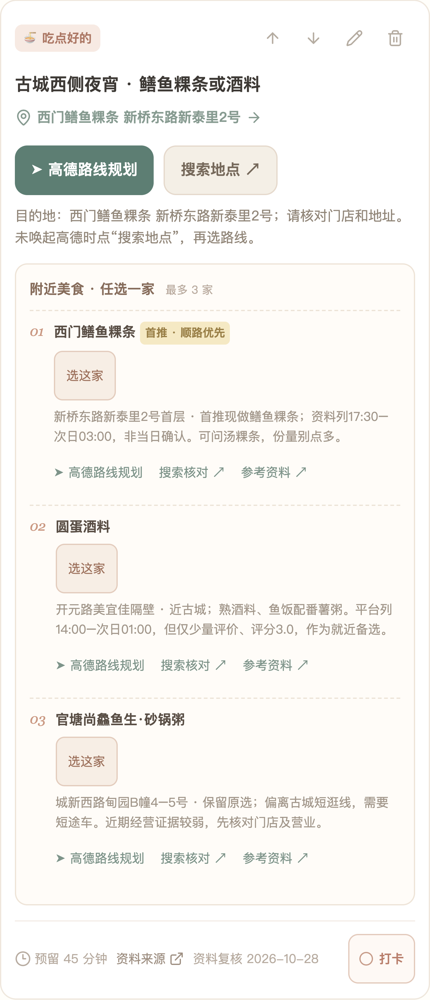
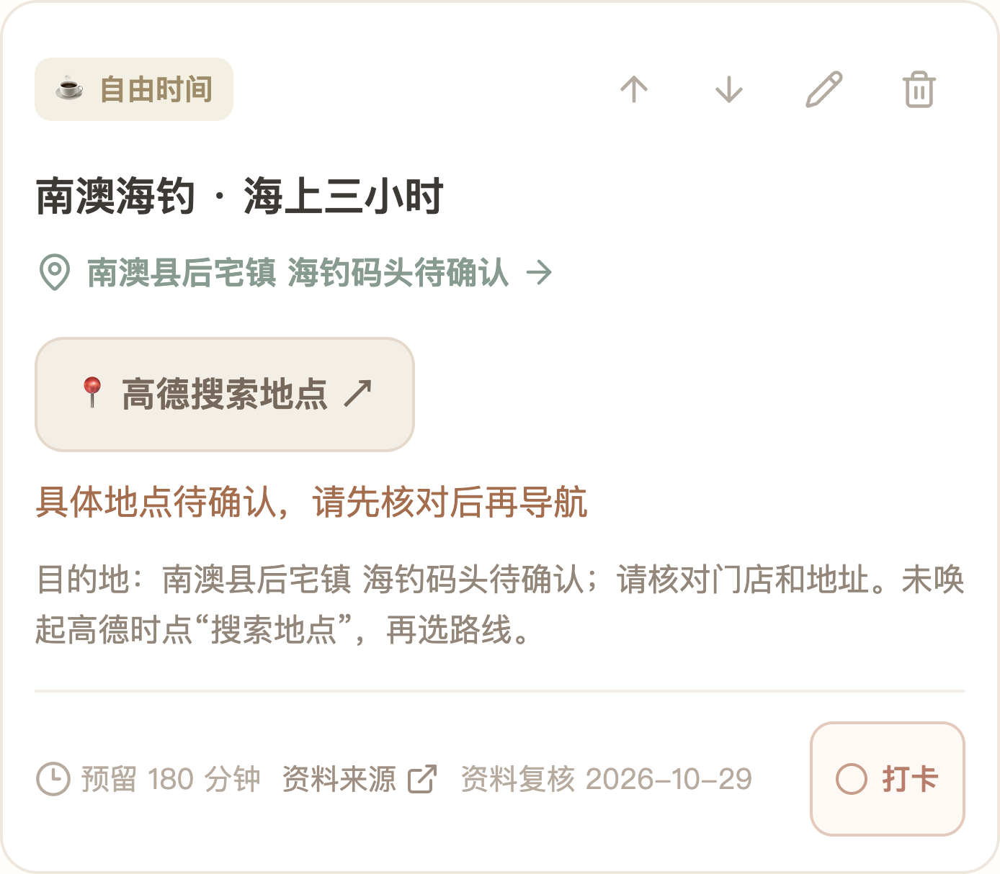
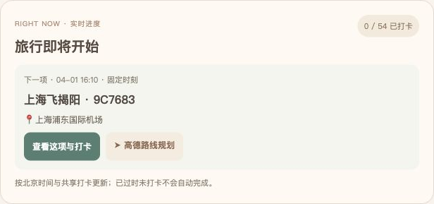
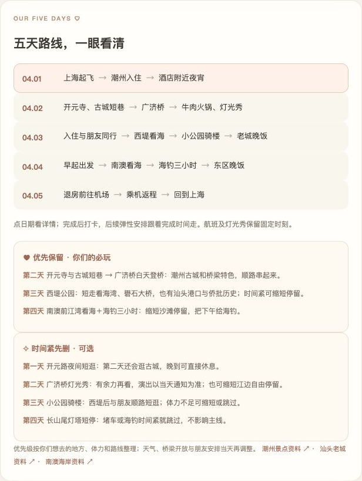
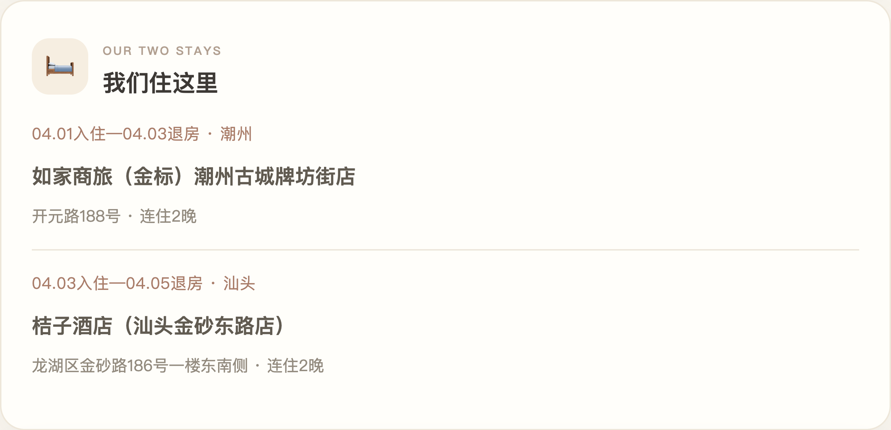
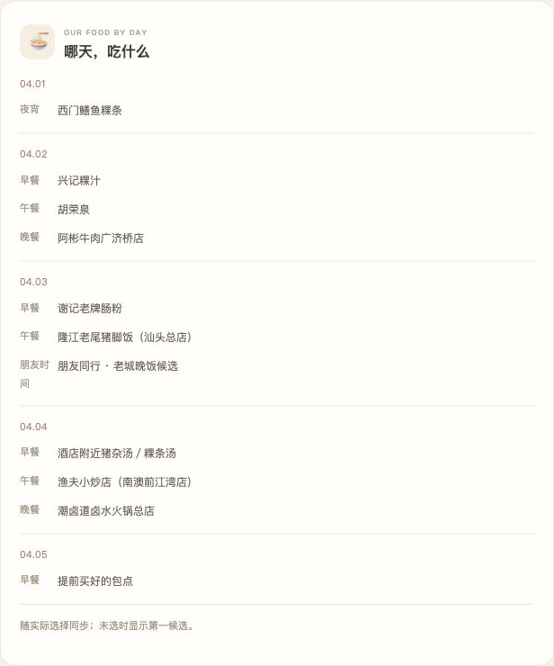
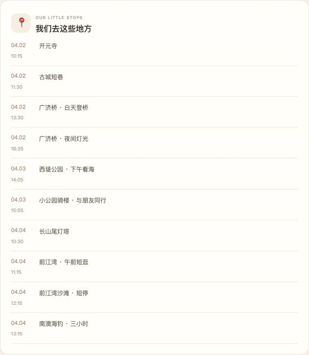

<div align="center">

# 一键生成 · 省心旅行攻略

### 把攻略交给 AI，把时间留给旅行。

**多平台信息整理 · 顺路安排景点与餐厅 · 手机旅行手账 · 一张图看懂路线**

一份从「去哪玩、吃什么」到「下一站怎么走」都考虑周到的旅行规划 Skill。

[快速开始](#-快速开始) · [安装方法](#-安装方法) · [核心亮点](#-为什么更省心) · [潮汕案例](#-潮汕旅行案例实际需求如何变成攻略) · [更新日志](#-更新日志--2026-10-29) · [使用边界](#-使用边界)

</div>


## ✨ 这是什么？

**一键生成 · 省心旅行攻略** 是一个面向 Codex 的旅行规划 Skill。告诉 AI 你的目的地、日期、同行人数、住宿和偏好，它会按一套经过真实旅行任务打磨的方法，研究并整理适合你的行程，并在环境支持时生成手机旅行网页和路线图片。

它的核心不是把热门景点简单罗列出来，而是先想清楚：**住在哪里、每天从哪出发、景点和餐厅是否顺路、走多少路、交通要花多久、什么时候需要预约**。再把这些拼成一条可执行、少折返的路线。

> 本仓库是 **Skill 指令包**，由 AI 助手依照指令研究、规划和生成交付物；不是独立运行的软件，也不内置旅行网站源码、平台接口或托管服务。生成效果依赖所用助手的工具、联网能力与部署环境。

## 🚀 快速开始

安装后，在 Codex 中直接说：

```text
使用 $travel-itinerary，帮我规划一次旅行。
出发地和目的地：……
日期和人数：……
已订航班、酒店：……
预算、喜欢的美食和体力情况：……
请生成手机可看的旅行网页和路线图。
```

信息还没想全也没关系：先提供已有信息，助手可以从路线和预订等关键问题开始整理。

## 📦 安装方法

### 方法一：直接让 Codex 安装

在 Codex 中发送：

```text
请安装 https://github.com/linyoungjiang0617-stack/travel-itinerary-skill 中的 travel-itinerary Skill，安装好后帮我规划旅行。
```

### 方法二：手动安装（macOS / Linux）

```bash
git clone https://github.com/linyoungjiang0617-stack/travel-itinerary-skill.git
mkdir -p ~/.codex/skills
cp -R travel-itinerary-skill/travel-itinerary ~/.codex/skills/
```

如果已有同名 Skill，先检查并备份原目录，避免覆盖自己的修改。安装后在新的 Codex 会话使用 `$travel-itinerary`；如果当前会话尚未显示新 Skill，可重新打开会话。

### Windows PowerShell

```powershell
git clone https://github.com/linyoungjiang0617-stack/travel-itinerary-skill.git
New-Item -ItemType Directory -Force "$HOME\.codex\skills" | Out-Null
Copy-Item -Recurse travel-itinerary-skill\travel-itinerary "$HOME\.codex\skills\travel-itinerary"
```

其他支持 `SKILL.md` 的助手可阅读并按自身规范导入指令；兼容性未逐一验证。

## 🧭 为什么更省心？

| 关心的问题 | 规划时如何处理 |
| --- | --- |
| 不想来回跑 | 以酒店、交通枢纽和固定事项为起点，把相邻景点与餐厅串成路线，尽量少折返。 |
| 不想太累 | 根据体力、步行距离和游览时长安排节奏；可设置必玩、可选和天气备选。 |
| 想吃有地方特色的 | 每个用餐节点结合路线推荐候选，兼顾品类、排队和用户已经选过的餐厅。 |
| 资料太散看不过来 | 在可访问的范围内整理官方旅游资料、商家信息、地图及小红书、抖音、大众点评等平台的公开攻略与评价，交叉核实位置、营业和体验信息。 |
| 不想错过关键时间 | 保留航班等固定事项，安排接送、购票和预订余量；实际打卡可用于推算后续弹性安排。 |
| 花了多少钱不清楚 | 按同行人数记录预估与实付，单独保护已确认订单，再汇总总额与人均。 |

社交平台的公开内容是否能访问，取决于平台限制、权限和助手工具；**本 Skill 未直接接入或保证抓取小红书、抖音、大众点评的全部内容**。有争议或无法核实的信息应标明来源和不确定性，不能把广告或旧攻略当成事实。

## 📱 潮汕旅行案例：实际需求如何变成攻略？

这次实践以双人潮汕之行为例（航班号：去程 9C7683，返程 9C8678）：从潮州古城开始，串联开元寺、古城巷子和广济桥，再前往汕头游览西堤公园与小公园骑楼，最后安排南澳岛看海。餐饮穿插在同一片游览区域中，跨城顺序、体力、步行和预留时间一起考虑，尽量少走回头路。

### 原版网页 · 功能展示

以下截图来自潮汕网页的本地脱敏副本，按功能选择代表性模块；酒店名称和航班号采用实际案例；日期和部分时间替换为示例，订单金额和部分私人备注已隐藏，预算数值为虚构示例。点击图片可查看原图。

#### 🗺️ 行程卡片与地图导航

每个景点或交通节点都有独立卡片，可以查看目的地、预留时间并手动打卡；右上角可调整顺序、编辑或删除。地点明确时可打开高德路线规划，信息待核对时则提供地点搜索。网页根据打卡进度推算后续弹性安排，固定事项发生时间冲突时会提示。

<p align="center"><a href="docs/case-day-2-1.png"></a></p>

#### 🍜 餐饮候选与选择

每餐最多展示三家候选，标出首推和顺路理由；可以选择一家，并分别查看地图、路线和参考资料。网页也会提示已选过的餐饮或重复品类，营业时间和评价仍需出行前核对。

<p align="center"><a href="docs/case-day-1-2.png"></a></p>

#### 🎣 待确认地点与准备提醒

尚未确定的集合点会标为“地点待确认”，可先使用地图搜索，再核实具体地址。网页另有排队、购票和约车准备事项汇总，打卡后可提醒下一项需要提前留意的事情；海钓预约、天气和集合方式需要自行确认。

<p align="center"><a href="docs/case-day-4-2.png"></a></p>

#### ⏱️ 当前与接下来

首页结合时间、行程和打卡进度显示当前或下一项，并提供查看项目和地图入口。计划时间已过但没有打卡时只会提醒，不会自动标记完成。

<p align="center"><a href="docs/case-feature-progress.png"></a></p>

#### 🧭 路线总览与必玩、可选

按日期一眼查看每天的路线，点击日期可跳转对应行程；下方把必玩与可选项目分开，方便时间不足或体力有限时调整。

<p align="center"><a href="docs/case-feature-route.png"></a></p>

#### 🛏️ 住宿一览

集中展示旅行中的住宿位置和入住天数，方便随时查看或进入地图核对。截图展示实际选择的酒店，入住日期为示例，已确认订单的真实金额未公开。

<p align="center"><a href="docs/case-feature-stay.png"></a></p>

#### 🍽️ 每天吃什么

集中查看每天的餐饮安排；选择餐厅后相应内容同步更新，尚未选择时显示第一候选，方便对照行程查看。

<p align="center"><a href="docs/case-feature-food.png"></a></p>

#### 📍 目的地一览

将旅行中的景点集中列出，附对应日期和预计时间，便于快速查看想去的地方。截图中的日期和部分时刻为示例。

<p align="center"><a href="docs/case-feature-places.png"></a></p>

#### 💰 预算明细

汇总两人预估与已记账金额，并计算人均费用；展开后可按天查看明细。已确认订单金额受保护，其余费用可在消费后填写实付。截图中的金额均为虚构示例。

<p align="center"><a href="docs/case-feature-budget.png"></a></p>

#### ☀️ 天气与行程取舍

提供天气、交通或活动取消时的人工调整建议，并附天气信息入口；是否更改路线由旅行者自行决定，网页不会自动更改行程。

<p align="center"><a href="docs/case-feature-weather.png"></a></p>

**功能范围：**网页提供资料入口和准备提醒，不代购车票、机票或门票，不代订酒店、餐厅或海钓，也不自动取号、约车或付款；没有承诺实时排队数据。

**高德地图：**普通手机浏览器可尝试唤起高德 App；微信内可能拦截，页面提供网页版搜索、复制地点及浏览器打开指引。门店地址及未确认的集合点需要再次核对，App 唤起与微信兼容受设备及网络影响。

> 上述功能来自一次实际网页案例；Skill 是指导助手生成的指令包，其他行程的具体功能和部署结果取决于执行环境。

### 住宿与美食如何筛选？

住宿按**位置方便、舒适、性价比**优先，案例选择了潮州古城附近和汕头东区的舒适型连锁酒店，以减少搬行李与跨区往返；案例选择如家商旅（金标）潮州古城牌坊街店及桔子酒店（汕头金沙东路店），订单金额不公开。舒适度、房价和入住条件仍以实际订单及住客需求为准。

餐饮结合中文互联网可访问的旅行攻略、地图、商家信息和食客评价筛选，**优先寻找有经营记录的地方特色老店**，再按路线、口味、排队与营业时间取舍。部分候选仅有平台或旅游目录记录，历史、近期经营或评价证据不够充分，不能一概称为已证实的老店，也不保证所有资料来自小红书、抖音或大众点评。可参考案例当时使用的[潮州美食资料](https://www.czcityofgastronomy.com/detail/1460)、[广济桥游览信息](https://static.nfnews.com/content/202601/19/c12092364.html)及[汕头西堤公园资料](https://www.shantou.gov.cn/stscgj/gkmlpt/content/2/2398/mpost_2398313.html)，出行前仍应重新核验。

## 📝 更新日志 · 2026-10-29

### 从潮汕旅行实践中整理出可复用方法

- 围绕住宿位置，把古城、美食、海边、跨城交通及返程串成连贯路线，按个人体力优化游览节奏。
- 在旅行网页实践中加入实时进度、手动打卡、弹性顺延、固定事项提醒、地图入口、备选交通及预算明细。
- 复盘并修正首次加载误报过时、晚餐准备提醒滞后、人均金额显示精度等问题；整理微信地图备用方案。
- 补充高清路线图片，便于把每天的关键节点和时间保存到手机。
- 将以上经验整理为可复用 Skill；公开展示图对个人订单信息进行了脱敏处理。

该实践中的本地测试覆盖了导航入口、时间逻辑、费用和两个页面的共享同步；**真实 iOS / Android 微信跳转及中国大陆移动网络访问尚未完成实测**。不同目的地需重新研究和验证。

## 🛠️ 工作流程

1. **了解你**：日期、人数、目的地、交通、住宿、预算、口味和体力。
2. **研究信息**：查找并核验可访问的攻略和官方信息，记录来源与核验时间。
3. **规划路线**：按地理位置串联景点、餐厅和交通，预留休息及排队时间。
4. **生成与验证**：在可用环境中制作共享网页与路线图片，检查功能和实际限制。

## ⚠️ 使用边界

- 门店营业、交通、航班、票价和天气随时可能变化；出发前请再次核实，无法确认的信息应标注待核。
- 远期天气不应当作准确预报；海上活动等需以当天条件和服务商通知为准。
- 共享网页的隐私与编辑权限由实际部署设置决定；可编辑链接可能被持有者修改。
- 微信打开高德 App 的能力、国内网络访问、双设备同步及托管费用取决于平台和设备，需实测；Skill 本身不提供免费服务器、数据库或域名。
- 未经用户要求不会公开个人旅行订单、酒店、航班或共享链接；本案例中的酒店和航班号经用户同意展示。

## 📂 文件结构

```text
travel-itinerary/
├── SKILL.md                  # 旅行研究与生成流程
├── references/website.md     # 网页和共享数据设计要点
└── agents/openai.yaml        # Codex 展示信息
```

## 📄 许可证

[MIT License](LICENSE)
