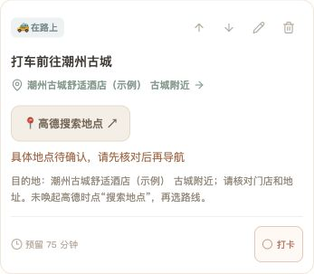
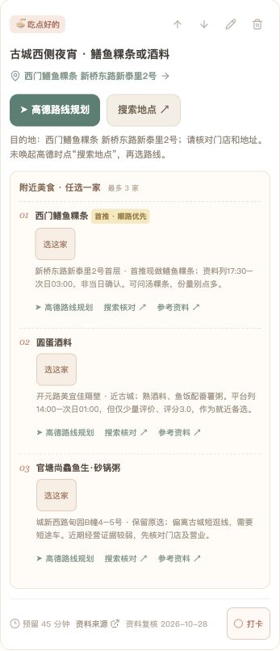
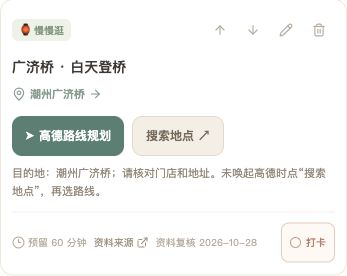
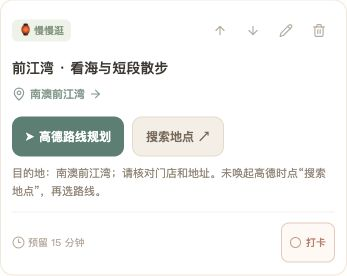
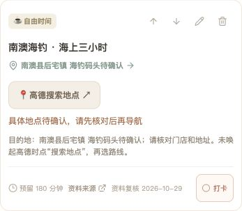

<div align="center">

# 一键生成 · 省心旅行攻略

### 把攻略交给 AI，把时间留给旅行。

**多平台信息整理 · 顺路安排景点与餐厅 · 手机旅行手账 · 一张图看懂路线**

一份从「去哪玩、吃什么」到「下一站怎么走」都考虑周到的旅行规划 Skill。

[快速开始](#-快速开始) · [安装方法](#-安装方法) · [核心亮点](#-为什么更省心) · [潮汕案例](#-潮汕旅行案例实际需求如何变成攻略) · [更新日志](#-更新日志--2026-10-29) · [使用边界](#-使用边界)

</div>


## ✨ 这是什么？

**一键生成 · 省心旅行攻略** 是一个面向 Codex 的旅行规划 Skill。告诉 AI 你的目的地、日期、同行人数、住宿和偏好，它会按一套经过真实旅行任务打磨的方法，研究并整理适合你的行程，并在环境支持时生成手机旅行网页和路线图片。

它的核心不是把热门景点简单罗列出来，而是先想清楚：**住在哪里、每天从哪出发、景点和餐厅是否顺路、走多少路、交通要花多久、什么时候需要预约**。再把这些拼成一条可执行、少折返的路线。

> 本仓库是 **Skill 指令包**，由 AI 助手依照指令研究、规划和生成交付物；不是独立运行的软件，也不内置旅行网站源码、平台接口或托管服务。生成效果依赖所用助手的工具、联网能力与部署环境。

## 🚀 快速开始

安装后，在 Codex 中直接说：

```text
使用 $travel-itinerary，帮我规划一次旅行。
出发地和目的地：……
日期和人数：……
已订航班、酒店：……
预算、喜欢的美食和体力情况：……
请生成手机可看的旅行网页和路线图。
```

信息还没想全也没关系：先提供已有信息，助手可以从路线和预订等关键问题开始整理。

## 📦 安装方法

### 方法一：直接让 Codex 安装

在 Codex 中发送：

```text
请安装 https://github.com/linyoungjiang0617-stack/travel-itinerary-skill 中的 travel-itinerary Skill，安装好后帮我规划旅行。
```

### 方法二：手动安装（macOS / Linux）

```bash
git clone https://github.com/linyoungjiang0617-stack/travel-itinerary-skill.git
mkdir -p ~/.codex/skills
cp -R travel-itinerary-skill/travel-itinerary ~/.codex/skills/
```

如果已有同名 Skill，先检查并备份原目录，避免覆盖自己的修改。安装后在新的 Codex 会话使用 `$travel-itinerary`；如果当前会话尚未显示新 Skill，可重新打开会话。

### Windows PowerShell

```powershell
git clone https://github.com/linyoungjiang0617-stack/travel-itinerary-skill.git
New-Item -ItemType Directory -Force "$HOME\.codex\skills" | Out-Null
Copy-Item -Recurse travel-itinerary-skill\travel-itinerary "$HOME\.codex\skills\travel-itinerary"
```

其他支持 `SKILL.md` 的助手可阅读并按自身规范导入指令；兼容性未逐一验证。

## 🧭 为什么更省心？

| 关心的问题 | 规划时如何处理 |
| --- | --- |
| 不想来回跑 | 以酒店、交通枢纽和固定事项为起点，把相邻景点与餐厅串成路线，尽量少折返。 |
| 不想太累 | 根据体力、步行距离和游览时长安排节奏；可设置必玩、可选和天气备选。 |
| 想吃有地方特色的 | 每个用餐节点结合路线推荐候选，兼顾品类、排队和用户已经选过的餐厅。 |
| 资料太散看不过来 | 在可访问的范围内整理官方旅游资料、商家信息、地图及小红书、抖音、大众点评等平台的公开攻略与评价，交叉核实位置、营业和体验信息。 |
| 不想错过关键时间 | 保留航班等固定事项，安排接送、购票和预订余量；实际打卡可用于推算后续弹性安排。 |
| 花了多少钱不清楚 | 按同行人数记录预估与实付，单独保护已确认订单，再汇总总额与人均。 |

社交平台的公开内容是否能访问，取决于平台限制、权限和助手工具；**本 Skill 未直接接入或保证抓取小红书、抖音、大众点评的全部内容**。有争议或无法核实的信息应标明来源和不确定性，不能把广告或旧攻略当成事实。

## 📱 潮汕旅行案例：实际需求如何变成攻略？

这次实践以双人潮汕之行为例：从潮州古城开始，串联开元寺、古城巷子和广济桥，再前往汕头游览西堤公园与小公园骑楼，最后安排南澳岛看海。餐饮穿插在同一片游览区域中，跨城顺序、体力、步行和预留时间一起考虑，尽量少走回头路。

### 原版网页 · 五天图文案例

以下截图取自原网页的本地脱敏副本，每天挑选两个行程模块展示。酒店、航班、日期和部分时间为示例，订单金额及部分私人备注已隐藏；截图不可用于实际出行。每一天下面的文字补充完整路线，截图只展示代表性节点。

#### DAY 01 · 抵达潮州：先安顿，再就近吃夜宵

从揭阳潮汕机场取行李后直接去古城附近住宿，放下行李再在西侧吃夜宵；有余力可顺路看一小段开元路夜景。首选**西门鳝鱼粿条**，备选圆蛋酒料；官塘尚鱻鱼生·砂锅粥较远，需另乘车且经营待核。这样避免刚落地就带行李来回找店。

 

#### DAY 02 · 潮州古城：寺庙、短巷、广济桥与夜景

从**兴记粿汁**早餐去开元寺，穿过一小段古城巷子到**胡荣泉**吃鸭母捻等小食，再经广济楼前往广济桥白天登桥。下午在韩江西岸与广济门城楼附近看江、坐坐；晚餐选东门街的**阿彬牛肉广济桥店**，饭后从西岸看灯光秀，再打车回住宿。白天与夜间都围绕广济桥一带，不额外跨区折返。

 

#### DAY 03 · 潮州到汕头：西堤、小公园与朋友同行

退房带行李后吃**谢记老牌肠粉**（文香肠粉为备选），直接跨城前往汕头东区入住，与朋友同行。午餐首选**隆江老尾猪脚饭**，然后乘车去西堤公园看海湾与礐石大桥，短途接驳到小公园中山纪念亭和骑楼；老城自由活动后，附近可选**飘香小食店、老二炒粿、福合埕牛肉丸**，再回东区住宿。没有反复回酒店的中转。

 

#### DAY 04 · 南澳岛：看海、吃海鲜与海钓

东区附近早餐后出发，先短停**长山尾灯塔**，再沿海去**前江湾**；后宅午餐首选渔夫小炒店，备选阿伟海鲜坊、好再来饭店。沙滩坐坐后，前往待确认的集合点登船，预留约三小时海钓；返城后在东区吃潮卤道卤水鹅类晚餐，再回住宿整理行李。若风浪或船班不允许出海，则保留沙滩慢游，视返程路线考虑钱澳湾灯塔。

 

#### DAY 05 · 汕头返程：退房后留足机场余量

早餐提前准备，当天起床洗漱、退房带齐行李，按固定返程时间倒推乘车前往**揭阳潮汕机场**，预留路程及办理手续时间，再搭乘航班返程。截图中的示例时间和酒店并非真实订单。

 

截图保留案例中的景点及餐饮候选；门店营业、景点开放、交通以及海钓码头与船位都需要出行前重新确认。

### 住宿与美食如何筛选？

住宿按**位置方便、舒适、性价比**优先，案例选择了潮州古城附近和汕头东区的舒适型连锁酒店，以减少搬行李与跨区往返；具体酒店名称和订单信息不公开。舒适度、房价和入住条件仍以实际订单及住客需求为准。

餐饮结合中文互联网可访问的旅行攻略、地图、商家信息和食客评价筛选，**优先寻找有经营记录的地方特色老店**，再按路线、口味、排队与营业时间取舍。部分候选仅有平台或旅游目录记录，历史、近期经营或评价证据不够充分，不能一概称为已证实的老店，也不保证所有资料来自小红书、抖音或大众点评。可参考案例当时使用的[潮州美食资料](https://www.czcityofgastronomy.com/detail/1460)、[广济桥游览信息](https://static.nfnews.com/content/202601/19/c12092364.html)及[汕头西堤公园资料](https://www.shantou.gov.cn/stscgj/gkmlpt/content/2/2398/mpost_2398313.html)，出行前仍应重新核验。

### 原版网页有哪些板块？

| 板块 | 可以做什么 |
| --- | --- |
| 当前与接下来 | 根据时间、计划和打卡状态显示当前事项和下一项；过时未打卡只提醒。 |
| 五天路线与必玩 / 可选 | 按日查看路线概览，时间紧或体力不足时参考可选项。 |
| 每日行程 | 查看景点、餐饮、步行估算、交通及备注，支持增删改和手动打卡。 |
| 餐饮、住宿和景点 | 在侧栏集中查看当天吃什么、住哪里、有哪些目的地；餐饮候选可选择并提示重复品类。 |
| 预算明细 | 录入两人实付，查看总额、人均及逐项明细；已确认订单金额受保护。 |
| 提前准备与提醒 | 汇总排队、购票和约车等准备事项；打卡后提示下一步需留意的事项。 |
| 天气取舍 | 根据天气提示海岛行程的人工调整思路；不是自动替你改行程。 |

**功能范围：只提供准备提醒和资料入口，不代购车票、机票或门票，不代订酒店、餐厅或海钓，不自动取号、约车或付款。** 此项目也没有承诺实时排队数据。

**高德地图：**行程节点和餐饮候选提供地点搜索、路线规划入口；普通手机浏览器可尝试唤起高德 App，微信内可能拦截，页面提供网页版搜索、复制地点及浏览器打开指引。具体门店、地址和未确认的集合点应在地图中再次核对，App 唤起与微信兼容受设备及网络影响。

> 上述模块来自一次实际案例；Skill 是指导助手生成的指令包，其他行程的具体功能和部署结果取决于执行环境。

## 📝 更新日志 · 2026-10-29

### 从潮汕旅行实践中整理出可复用方法

- 围绕住宿位置，把古城、美食、海边、跨城交通及返程串成连贯路线，按个人体力优化游览节奏。
- 在旅行网页实践中加入实时进度、手动打卡、弹性顺延、固定事项提醒、地图入口、备选交通及预算明细。
- 复盘并修正首次加载误报过时、晚餐准备提醒滞后、人均金额显示精度等问题；整理微信地图备用方案。
- 补充高清路线图片，便于把每天的关键节点和时间保存到手机。
- 将以上经验整理为可复用 Skill；公开展示图对个人订单信息进行了脱敏处理。

该实践中的本地测试覆盖了导航入口、时间逻辑、费用和两个页面的共享同步；**真实 iOS / Android 微信跳转及中国大陆移动网络访问尚未完成实测**。不同目的地需重新研究和验证。

## 🛠️ 工作流程

1. **了解你**：日期、人数、目的地、交通、住宿、预算、口味和体力。
2. **研究信息**：查找并核验可访问的攻略和官方信息，记录来源与核验时间。
3. **规划路线**：按地理位置串联景点、餐厅和交通，预留休息及排队时间。
4. **生成与验证**：在可用环境中制作共享网页与路线图片，检查功能和实际限制。

## ⚠️ 使用边界

- 门店营业、交通、航班、票价和天气随时可能变化；出发前请再次核实，无法确认的信息应标注待核。
- 远期天气不应当作准确预报；海上活动等需以当天条件和服务商通知为准。
- 共享网页的隐私与编辑权限由实际部署设置决定；可编辑链接可能被持有者修改。
- 微信打开高德 App 的能力、国内网络访问、双设备同步及托管费用取决于平台和设备，需实测；Skill 本身不提供免费服务器、数据库或域名。
- 未经用户要求不会公开个人旅行订单、酒店、航班或共享链接。

## 📂 文件结构

```text
travel-itinerary/
├── SKILL.md                  # 旅行研究与生成流程
├── references/website.md     # 网页和共享数据设计要点
└── agents/openai.yaml        # Codex 展示信息
```

## 📄 许可证

[MIT License](LICENSE)
